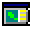

# Retro Skin for QGIS



**Just for fun!** Retro Skin is a playful toy for GIS nostalgics: it adds no
analysis feature, it just dresses QGIS up like the desktop GIS of the '90s and
early 2000s. **Anyone is free to create and share their own skins.**

*[Leggi in italiano](#italiano)*

## Why Retro Skin

I created this plugin in a moment of nostalgia for the old days. There is no intention to compare or compete with any software: it’s just for fun. Technology moves fast, and sometimes a single icon is enough to unlock a memory. Retro Skin is a small time machine for QGIS: pick a skin, smile, and switch back to the standard look whenever you like.

## Included skins

| Skin | Look |
|------|------|
| Vintage 95 | Windows 95 grey, raised buttons, 16x16 pixel-art icons |
| ArcView 3.x style | '90s desktop GIS: Themes, raised Table of Contents |
| ArcMap 8.x style | Early 2000s: Windows 2000, flat toolbars, light blue selection |

Switch skins from **Plugins > Retro Skin**, from the toolbar button or with
**Ctrl+Alt+K**. *QGIS (original)* restores the standard look. The interface is
in English, or in Italian when QGIS is set to Italian.

Works with QGIS 3.22+ and QGIS 4 (Qt6).

## Create your own skin

A skin is just a folder in `retro_skin/skins/<id>/`. The quickest way: open
**Plugins > Retro Skin > Create your own skin**, copy an existing folder, rename
it and edit it. Restart QGIS (or reload the plugin) and it shows up in the menu.

```
skins/my_skin/
├── skin.json     # name, stylesheet, icon mapping (required)
├── style.qss     # Qt stylesheet
└── icons/        # <name>.png (16 px) and <name>@2x.png (32 px, HiDPI)
```

`skin.json`:

```json
{
  "name": "My skin",
  "description": "Short tooltip",
  "description_it": "Optional Italian tooltip",
  "stylesheet": "style.qss",
  "toolbar_icon_size": 16,
  "icons": {
    "zoom_in": ["mActionZoomIn"],
    "pan": ["mActionPan"]
  },
  "menus": { "mLayerMenu": "&Theme" },
  "docks": { "Layers": "Table of Contents" },
  "toolbars": [
    { "name": "My Bar", "actions": ["mActionZoomIn", "|", "mActionPan"] }
  ]
}
```

- `icons`: maps a PNG name (without extension) to the `objectName`s of the QGIS
  actions that should use it.
- `menus` / `docks` (optional): alternative titles for menus and panels, by
  `objectName`.
- `toolbars` (optional): extra toolbars built from QGIS actions; `|` is a separator.
- In `style.qss` the placeholder `@SKINS_DIR@` is replaced with the path of the
  `skins` folder (useful for `url(...)` images).

Tip: in the QGIS Python console, `[a.objectName() for a in iface.mainWindow().findChildren(QAction) if a.objectName()]`
lists the action names.

Made a nice skin? Open a pull request or an issue: we'd love to see it!

## Build the package

```
python3 scripts/package.py
```

creates `dist/retro_skin-<version>.zip`, ready to upload to
[plugins.qgis.org](https://plugins.qgis.org), after checking the metadata and
files required by the repository.

## License

GPL v2 or later, see [LICENSE](LICENSE). All icons are original pixel art.

---

## Italiano

**Solo per gioco!** Retro Skin è un giocattolo per i nostalgici del GIS: non
aggiunge funzioni di analisi, veste semplicemente QGIS come i GIS desktop degli
anni '90 e primi 2000. **Ognuno può creare e condividere liberamente le proprie
skin.**

### Perché Retro Skin

Ho creato questo plugin in un momento di nostalgia per i tempi andati. Non c’è alcuna volontà di mettere a confronto o in competizione nessun software: è solo un gioco. La tecnologia corre veloce, e a volte basta un’icona per sbloccare un ricordo. Retro Skin è una piccola macchina del tempo per QGIS: scegli una skin, fatti un sorriso e torna all'aspetto standard quando vuoi.

Le skin si cambiano da **Plugin > Retro Skin**, dal pulsante in toolbar o con
**Ctrl+Alt+K**; *QGIS (originale)* ripristina l'aspetto standard. L'interfaccia
è in italiano se QGIS è impostato in italiano, altrimenti in inglese.

### Crea la tua skin

Una skin è una cartella in `retro_skin/skins/<id>/` con `skin.json`, `style.qss`
e le icone PNG (16 px e `@2x` da 32 px). Da **Plugin > Retro Skin > Crea la tua
skin** si apre la cartella: copia una skin esistente, rinominala e modificala;
al riavvio di QGIS comparirà nel menu. Il formato di `skin.json` è descritto
nella sezione inglese qui sopra (`description_it` è la descrizione in italiano).

Hai fatto una bella skin? Apri una pull request o una issue!

Tutte le icone sono pixel-art originale. Licenza GPL v2 o successiva.
